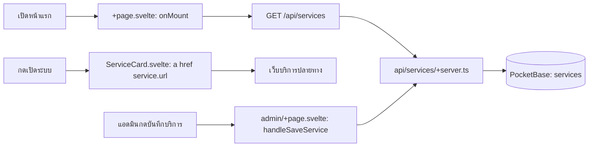

# services-portal — กดแล้วโค้ดไปไหน

| ผู้ใช้ทำอะไร                     | ตามไฟล์และฟังก์ชัน                                                                                                                                                                | ผลลัพธ์                                                       |
| -------------------------------- | --------------------------------------------------------------------------------------------------------------------------------------------------------------------------------- | ------------------------------------------------------------- |
| เปิดหน้าแรก                      | `onMount()` ใน [+page.svelte](src/routes/+page.svelte) → `GET /api/services` ใน [api/services/+server.ts](src/routes/api/services/+server.ts)                                     | ดึงรายการ `services` จาก PocketBase แล้วสร้างการ์ด            |
| กด “เปิดระบบ” บนการ์ด            | `<a href={service.url}>` ใน [ServiceCard.svelte](src/lib/components/ServiceCard.svelte)                                                                                           | เปิด URL ของบริการปลายทางในแท็บใหม่ ไม่มี API call จากปุ่มนี้ |
| แอดมินกดบันทึกบริการ             | `handleSaveService()` ใน [admin/+page.svelte](src/routes/admin/+page.svelte) → `POST` หรือ `PATCH /api/services` ใน [api/services/+server.ts](src/routes/api/services/+server.ts) | ตรวจ session/admin แล้วสร้างหรือแก้ collection `services`     |
| แอดมินกดลบบริการ                 | `handleDeleteService()` → `DELETE /api/services` ใน [api/services/+server.ts](src/routes/api/services/+server.ts)                                                                 | ลบ record `services`                                          |
| แอดมินเพิ่ม/แก้/ลบ passion group | `handleSaveGroup()`/`handleDeleteGroup()` ใน [admin/+page.svelte](src/routes/admin/+page.svelte) → [api/passion-group/+server.ts](src/routes/api/passion-group/+server.ts)        | เปลี่ยน collection `passion_group`                            |

อ่าน [คู่มือระบบ](../Docs/HandOn/services-portal.md) สำหรับการดูแลรายการบริการ
