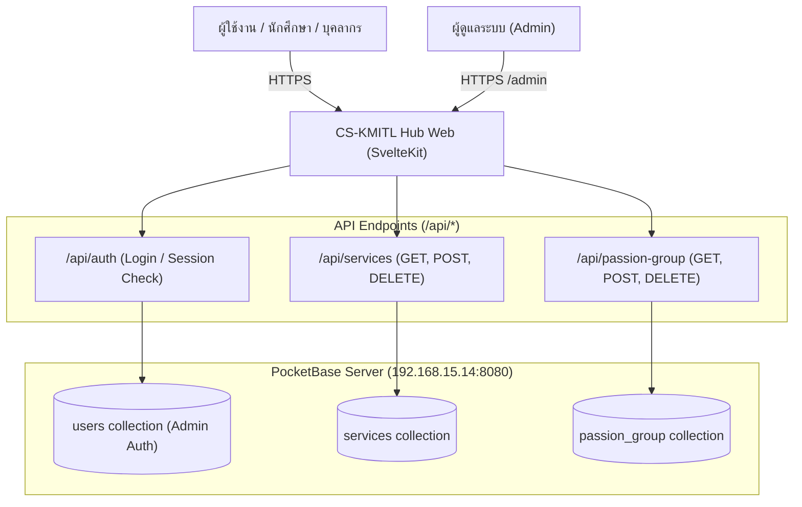

# CS-KMITL Hub (Services Portal & Community)

> ศูนย์กลางเชื่อมต่อบริการดิจิทัล (Services Hub) และคอมมูนิตี้กลุ่มความสนใจ (Passion Groups) สำหรับนักศึกษาและบุคลากร ภาควิชาวิทยาการคอมพิวเตอร์ สจล. (CS-KMITL)

[](https://github.com/CSNIS-CSKmitl/cskmitl-web/actions/workflows/ci.yml)
[](https://github.com/CSNIS-CSKmitl/cskmitl-web/actions/workflows/deploy.yml)

---

## 1. ฟีเจอร์หลัก (Features)

- **Central Services Hub**: แสดงและรวบรวมระบบบริการทั้งหมดของภาควิชา (เช่น Booking, Borrowly, Announcements, CSNIS, Printer Server, JupyterHub, init.d, Android App) พร้อมระบบฟิลเตอร์ตามประเภท (`Web app`, `Backend`, `Mobile`, `Infrastructure`)
- **Passion Groups Directory**: พื้นที่รวมกลุ่มความสนใจ ชุมชน ชมรม และกิจกรรมของนักศึกษา พร้อมช่องค้นหาแบบเรียลไทม์ และลิงก์เข้าร่วม Discord/Line/FB
- **All-in-One Admin Management Console**:
  - แดชบอร์ดจัดการข้อมูลบริการและ Passion Group ครบจบในที่เดียว
  - ปุ่ม Quick Action และ Modal Pop-up สะดวกสำหรับการเพิ่มกลุ่มหรือบริการใหม่ ไม่ต้องสลับหน้า
  - ระบบตรวจสอบสิทธิ์ Admin เชื่อมต่อ PocketBase Auth ปลอดภัย
  - ฟังก์ชันค้นหา, แก้ไขสถานะ และลบข้อมูลพร้อม Confirm ป้องกันการกดผิด
- **Clean & Elegant Theme**: ดีไซน์เรียบหรู คมชัด สไตล์ CS-KMITL Orange แบนราบ คลีนตา ไร้แสงสะท้อนนีออน

---

## 2. สแต็กเทคโนโลยี (Tech Stack)

| ส่วนประกอบ | เทคโนโลยีที่ใช้ | รายละเอียด |
| :--- | :--- | :--- |
| **Framework** | [Svelte 5](https://svelte.dev/) + [SvelteKit 2](https://kit.svelte.dev/) | Runes, SSR, API Endpoints |
| **Styling** | [Tailwind CSS v4](https://tailwindcss.com/) | Theme @theme, Utility-first CSS |
| **Icons** | [@lucide/svelte](https://lucide.dev/) | ไอคอนโมเดิร์น คมชัด เรียบหรู |
| **Backend & Database** | [PocketBase](https://pocketbase.io/) | Collections `services`, `passion_group`, `users` |
| **Runtime Adapter** | `@sveltejs/adapter-node` | Node.js standalone bundle ผ่าน `server.js` |
| **Process Manager** | PM2 | รัน Background Daemon บน Production Server |

---

## 3. สถาปัตยกรรมระบบ (System Architecture)



---

## 4. เริ่มต้นติดตั้งและรันในเครื่อง (Local Development)

### ความต้องการของระบบ (Prerequisites)
- Node.js version 22 หรือ 24
- npm version 10+
- PocketBase server ที่เข้าถึงได้ (เช่น `http://192.168.15.14:8080` หรือ local instance)

### ขั้นตอนการรัน
```bash
# 1. ติดตั้ง Dependencies
npm install

# 2. คัดลอกไฟล์ Environment Variables
cp .env.example .env

# 3. รัน Development Server
npm run dev
```

เปิดเบราว์เซอร์ไปที่: `http://localhost:5173/`

### คำสั่งสคริปต์ที่สำคัญ
```bash
npm run check   # ตรวจสอบ TypeScript & Svelte syntax ด้วย svelte-check
npm run build   # Build production standalone bundle ไปที่โฟลเดอร์ /build
npm run preview # ทดลองรัน production bundle ในเครื่อง
```

---

## 5. การตั้งค่า Environment Variables (`.env`)

| ตัวแปร | ตัวอย่างค่า | คำอธิบาย |
| :--- | :--- | :--- |
| `POCKETBASE_URL` | `http://192.168.15.14:8080` | URL ชี้ไปยัง PocketBase Core Server ฝั่ง Server-side |
| `PUBLIC_POCKETBASE_URL` | `http://192.168.15.14:8080` | (ตัวเลือก) URL PocketBase สำหรับฝั่ง Client-side |
| `PORT` | `3000` | พอร์ตที่ Node.js รันสำหรับ Production |
| `HOST` | `127.0.0.1` | Bind Host IP สำหรับ Production |

---

## 6. โครงสร้างโปรเจกต์ (Project Structure)

```text
services-portal/
├── .github/
│   └── workflows/
│       ├── ci.yml              # ตรวจสอบโค้ด & Build บน PR / Push ทุก Branch
│       └── deploy.yml          # CI/CD Deployment อัตโนมัติขึ้น Production Server
├── src/
│   ├── lib/
│   │   ├── components/
│   │   │   └── ServiceCard.svelte # การ์ดแสดงผลบริการและไอคอนเฉพาะทาง
│   │   ├── server/
│   │   │   └── pocketbase.ts   # PocketBase server client, auth helpers & token cookie
│   │   └── pocketbase.ts       # PocketBase client fallback
│   ├── routes/
│   │   ├── admin/
│   │   │   ├── +page.svelte    # Admin Console รวม (Services + Passion Groups)
│   │   │   └── passion-group/  # หน้าจัดการ Passion Group โดยเฉพาะ
│   │   ├── api/
│   │   │   ├── auth/           # Login / Logout / Auth check API
│   │   │   ├── passion-group/  # Passion Group API (CRUD)
│   │   │   └── services/       # Services API (CRUD)
│   │   ├── auth/               # OIDC SSO & callback routes
│   │   ├── passion-group/      # หน้าแสดงคอมมูนิตี้สำหรับผู้ใช้งานทั่วไป
│   │   ├── +layout.svelte      # Main Layout
│   │   └── +page.svelte        # หน้าแรก CS-KMITL Hub Portal
│   ├── app.css                 # สไตล์ Tailwind CSS v4 & Theme Colors
│   └── app.html                # HTML Base Template
├── ecosystem.config.cjs        # PM2 Configuration สำหรับรันบนเซิร์ฟเวอร์
├── server.js                   # Production Node.js Entry Point
├── package.json
└── vite.config.ts
```
